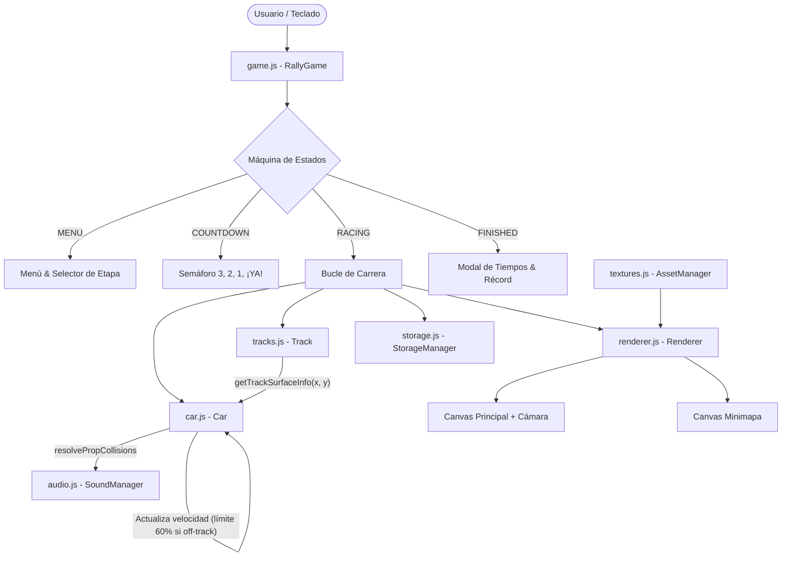

# WRC Top-Down Rally Championship - Contexto del Proyecto para Agentes

Bienvenido al repositorio del **WRC Top-Down Rally Championship**. Este documento proporciona la documentación técnica, arquitectónica y operativa esencial para cualquier agente de IA o desarrollador que trabaje en el mantenimiento, ampliación o depuración de este proyecto.

---

## 1. Visión General del Proyecto

- **Tipo**: Videojuego de carreras arcade con perspectiva cenital (*top-down*).
- **Temática**: Rally en diversas superficies (tierra nórdica, asfalto frío de montaña y arena desértica).
- **Plataforma**: Navegador Web moderno (Vanilla JavaScript ES6+, HTML5 Canvas, Web Audio API, CSS3).
- **Sin dependencias externas obligatorias**: El juego está diseñado sin frameworks pesados (React, Vue, Three.js o Phaser), funcionando fluidamente a 60 FPS directo sobre Canvas 2D.

### Características Principales
1. **3 Etapas Temáticas**:
   - **Etapa 1: Bosque de Finlandia** (Tierra / Gravilla, agarre medio-alto, rodeado de densos pinos).
   - **Etapa 2: Desfiladero Alpino** (Asfalto frío y nieve, curvas cerradas, abetos nevados y rocas).
   - **Etapa 3: Cañón del Desierto** (Arcilla compacta y arena profunda, rocas rojizas y arbustos).
2. **2 Formatos de Competición**:
   - **Tramo Rally (Punto A → Punto B)**: Recorrido abierto largo con arcos de salida, checkpoints intermedios y meta.
   - **Circuito Cerrado**: Trazado en bucle a 3 vueltas.
3. **Física de Conducción Rally**:
   - Inercia y derrape lateral (*drift*) dependiente de la tracción y freno de mano.
   - Emisión de marcas de neumáticos (*skid marks*) y partículas volumétricas de polvo/nieve.
4. **Regla de Fuera de Pista (60% de velocidad máxima)**:
   - En pista: hasta el 100% de velocidad máxima (560 px/s ≈ 200 km/h).
   - Fuera de pista: si el coche excede el 60% (336 px/s ≈ 120 km/h), desacelera rápidamente hasta no superar dicho umbral.
5. **Cámara y HUD**:
   - Cámara cenital con seguimiento suave y anticipación (*look-ahead* hacia donde se desplaza el coche).
   - Minimapa en la esquina inferior derecha mostrando el trazado, checkpoints y vehículo.
   - Velocímetro con indicador y marcador específico al 60%.
   - Semáforo y cuenta atrás inicial (`3, 2, 1, ¡YA!`).
   - Guardado automático de mejores tiempos en `localStorage`.
   - Audio sintetizado procedural mediante la API Web Audio (motor en función de RPM/velocidad, derrape, colisiones y beeps).

---

## 2. Estructura de Directorios y Archivos

```
/home/antonio/dev/test/
├── AGENTS.md               # Este archivo de documentación para agentes
├── index.html              # Estructura del DOM, lienzos Canvas y superposiciones (Menú, HUD, Modales)
├── css/
│   └── style.css           # Estilos WRC oscuros translúcidos, HUD, velocímetro, semáforo y minimapa
├── js/
│   ├── game.js             # Bucle principal (RAF), máquina de estados, controles y gestión del HUD
│   ├── car.js              # Física vectorial del coche, derrape, partículas y penalización al 60%
│   ├── tracks.js           # Splines Catmull-Rom de las etapas, detección de calzada, checkpoints y props
│   ├── renderer.js         # Renderizado multicapa en Canvas, cámara dinámica y minimapa
│   ├── textures.js         # Texturas procedurales tileables y procesador de sprites
│   ├── audio.js            # Síntesis WebAudio (osciladores, filtros biquad y ruido blanco)
│   └── storage.js          # Persistencia de tiempos y récords en localStorage
└── assets/
    ├── car_rally.png       # Sprite recortado y orientado del coche de rally (WRC Livery)
    └── props_sheet.png     # Hoja de sprites de entorno (árboles, rocas, barreras de neumáticos)
```

---

## 3. Arquitectura del Sistema



### Estados del Juego (`game.state`)
- `'MENU'`: Visualización panorámica de fondo, selección de etapa (1, 2, 3) y modo (`point_to_point` / `circuit`).
- `'COUNTDOWN'`: Inmoviliza el control de avance del coche; realiza cuenta regresiva 3, 2, 1 con sonido y semáforo.
- `'RACING'`: Cronómetro en marcha, controles habilitados, física activa, comprobación de checkpoints y control de límites de pista.
- `'FINISHED'`: Se frena el vehículo, se reproduce melodía de llegada, se calcula si es nuevo récord y se almacena en `localStorage`.

---

## 4. Módulos y Detalles de Implementación

### 4.1. Física y Superficie (`js/car.js` & `js/tracks.js`)
- **Constante Crítica**: `OFF_TRACK_MAX_SPEED_RATIO = 0.60`.
- **Detección de Calzada**:
  - `Track.getTrackSurfaceInfo(x, y)` proyecta ortogonalmente las coordenadas del coche contra los segmentos del spline central.
  - Si `distance <= halfWidth`: `isOnTrack = true` (pista).
  - Si `distance > halfWidth`: `isOnTrack = false` (hierba/nieve/arena).
- **Comportamiento Fuera de Pista**:
  - `currentMaxSpeed = isOnTrack ? maxSpeed : maxSpeed * 0.60`.
  - Si `speed > currentMaxSpeed`, se reduce a un ritmo de `offTrackDeceleration = 540 px/s²`.
  - La tracción se reduce un 28% y se eleva la resistencia a la rodadura.
- **Freno de Mano**:
  - Tecla `ESPACIO`: reduce agarre lateral un 58% y potencia la tasa de giro un 28% para inducir sobreviraje controlado.

### 4.2. Renderizado (`js/renderer.js` & `js/textures.js`)
- Orden de capas de dibujado:
  1. Fondo exterior (patrón tileable: `grass`, `snow` o `desert`).
  2. Bordes y arcenes exteriores.
  3. Pianos bicolor segmentados (`kerbColorA` y `kerbColorB`).
  4. Calzada asfaltada o de grava (`dirtRoad`, `tarmac`, `canyonRoad`).
  5. Trazada central y marcas de carril.
  6. Arcos de salida, checkpoints de control y pancarta de meta.
  7. Marcas de neumáticos persistentes y partículas activas.
  8. Coche de carreras (sombra proyectada, haz de faros y luces de freno).
  9. Elementos de vegetación y rocas (*frustum culling* para optimizar rendimiento).
  10. Viñeteado rojo de advertencia si `car.isOnTrack === false`.
- **Minimapa**:
  - Lienzo secundario fijo en la esquina que reescala la bounding box de la etapa, dibujando el contorno completo, puntos de control y un puntero orientado con la posición del jugador.

### 4.3. Persistencia de Tiempos (`js/storage.js`)
- Clave de almacenamiento: `rally_topdown_records_v1`.
- Los tiempos se guardan independientemente para cada combinación: `${stageId}_${mode}` (ejemplo: `stage1_point_to_point` y `stage1_circuit`).
- Formato del cronómetro: `mm:ss.ms` (ej. `01:14.320`).

---

## 5. Guía de Ejecución y Pruebas para Agentes

### 5.1. Levantar Servidor Local
Para probar en el navegador con soporte de módulos ES6:
```bash
python3 -m http.server 8080 --directory /home/antonio/dev/test
```
El juego estará accesible en `http://localhost:8080/`.

### 5.2. Test Automatizado de Lógica y Física
Se puede verificar la lógica de etapas, cálculo de checkpoints y penalización exacta del 60% sin navegador utilizando Node.js:
```bash
node -e '
import("./js/car.js").then(async ({ Car, OFF_TRACK_MAX_SPEED_RATIO }) => {
    const { STAGE_CONFIGS, Track } = await import("./js/tracks.js");
    const { StorageManager } = await import("./js/storage.js");

    for (const cfg of STAGE_CONFIGS) {
        const tP2P = new Track(cfg, "point_to_point");
        const tCirc = new Track(cfg, "circuit");
        if (tP2P.checkpoints.length === 0 || tCirc.checkpoints.length === 0) throw new Error("Checkpoints faltantes");
    }

    const car = new Car(0, 0, 0);
    const fullThrottle = { up: true, down: false, left: false, right: false, handbrake: false };
    for (let i = 0; i < 240; i++) car.update(1/60, fullThrottle, true, 0.94, null);
    if (Math.abs(car.speed - car.maxSpeed) > 1) throw new Error("Fallo en velocidad máxima en pista");

    for (let i = 0; i < 120; i++) car.update(1/60, fullThrottle, false, 0.94, null);
    const expected = car.maxSpeed * OFF_TRACK_MAX_SPEED_RATIO;
    if (Math.abs(car.speed - expected) > 1) throw new Error("Fallo en limitación al 60% fuera de pista");

    console.log("¡TODAS LAS PRUEBAS AUTOMATIZADAS HAN PASADO CON ÉXITO!");
});
'
```

---

## 6. Convenciones y Reglas para Futuras Modificaciones

1. **Mantener compatibilidad Web nativa**: No añadir empaquetadores (Webpack, Vite) a menos que se solicite expresamente; mantener importaciones ES Modules puras (`.js`).
2. **Respetar la penalización del 60%**: Cualquier modificación a la física en `car.js` debe preservar que la velocidad no supere `maxSpeed * 0.60` al salirse de pista.
3. **Coordinación de modos**: Al crear nuevas pistas en `tracks.js`, asegurarse de definir tanto `pointToPointWaypoints` como `circuitWaypoints`.
4. **Respeto a assets existentes**: Si se regeneran imágenes en `assets/`, verificar su orientación: el coche debe mirar hacia la **DERECHA** (`0 rad`) en su espacio de coordenadas locales.
